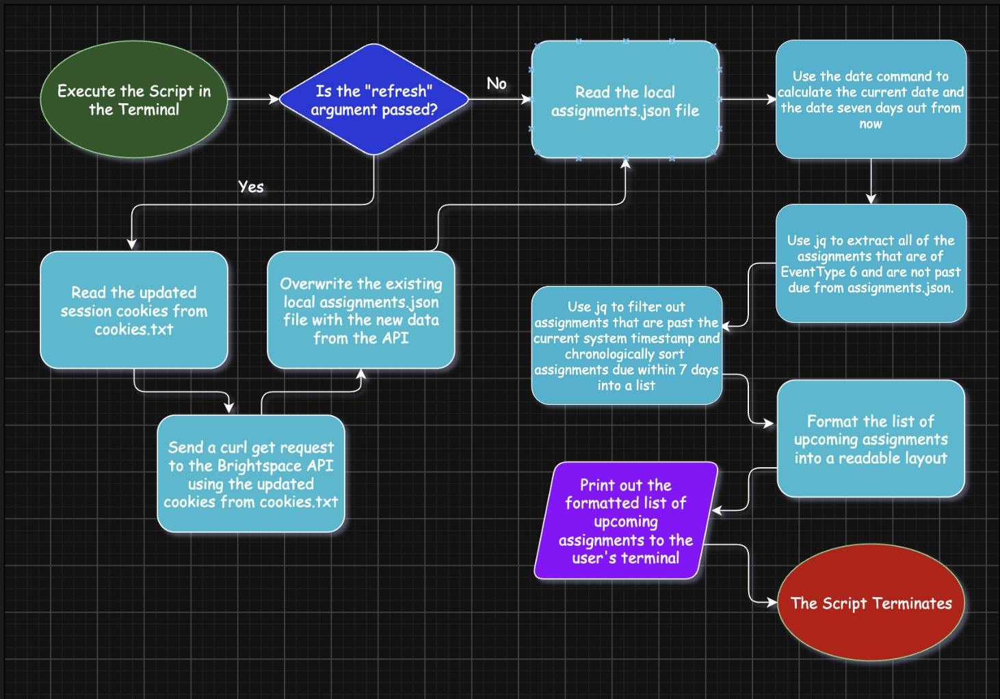

# Homework-Fetch

A Bash Script that can fetch upcoming assignments from Brightspace and display them within the terminal.

## The Problem/Project Goal

I'm trying to solve the hassle of having to log in to Brightspace multiple times a day to check my assignments. I often have to do this to avoid forgetting about assignments. I'm writing this Bash script to solve this problem by fetching upcoming assignments from Brightspace and displaying them within the terminal.

## How It Works

- Read session cookies from a local cookies.txt file.
- Fetch raw JSON data from the Brightspace REST API using curl.
- Cache the data locally in the assignments.json file.
- Extract assignments and their details using jq.
- Compare due dates of each assignment against the system timestamp using the date command and drop assignments that are past due.
- Format and print a clean list of upcoming assignments to the terminal.
- Implement a refresh argument that can be used to update the local assignments.json file when cookies.txt has updated session cookies.



## Tech Stack

- **Language**: Bash
- **Commands/Utilities**:
  - curl: Execute HTTP requests and attach session cookies for authentication.
  - jq: Extracting the relevant fields of the API's JSON file.
  - date: Filter assignments by the date string given by the API's JSON file.
- **Data Storage**:
  - A local JSON file called "assignments.json" will act as a cache to store the fetched assignments.
  - A local txt file called "cookies.txt" will securely store session cookies.
  - Both of these files are never commited to github and are included in .gitignore
- **External Source**: The Brightspace REST API
  - Will be accessed using curl get requests using the manually pasted cookies in cookies.txt.

## Prerequisites

Before running the script, ensure you have **Git** and **jq** installed:
- **macOS:** `brew install git jq` 
- **Windows (PowerShell):** `winget install Git.Git jqlang.jq` (Run the script using **Git Bash**)

## Setup Instructions
1. **Clone the repository:**
   ```bash
   git clone https://github.com/Panugu08/Homework-Fetch.git
   cd Homework-Fetch
   ```
2. **Get your Brightspace session cookie:**
  - Log into Brightspace on your browser.
  - Open the Developer Tools (**F12** or right-click and choose **Inspect**), navigate to the **Network** tab, and refresh the page.
  - Switch to the **Console** tab, type `fetch('/d2l/api/lp/1.33/users/whoami')`, and hit Enter.
  - Go back to the **Network** tab and click the **Fetch/XHR** filter.
  - Right-click the `whoami` request that appears, hover over **Copy**, and select **Copy as cURL (bash)**.

3. **Configure `cookies.txt`:**
  - Paste that text into a notepad and find the massive string next to the `-b` flag. 
  - Copy only the text _inside_ the single quotes (`'...'`). This is your `FULL_COOKIE_STRING`.
  - Rename the `cookies.example.txt` in this folder to `cookies.txt` and paste your string into the given template.
  - *(Security Note: Never share your `cookies.txt` file or commit it to GitHub—it grants full access to your Brightspace account.)*

4. **Run the script:**
   ```bash
   chmod +x homework.sh
   ./homework.sh
   ```

## Future Plans

- [ ] **Browser Extension Support**: Parse Netscape-formatted cookie files exported from browser extensions so that the user doesn't have to manually paste session cookies into cookies.txt
- [x] **Color coding**: Color coded terminal output based on urgency (Ex: Red for due in 24 hrs)
- [ ] **Due date countdowns**: Text displaying "Due in X days" next to each upcoming assignment instead of the actual due date.
- [ ] **Auto run**: Make the script run automatically when the terminal is opened
- [ ] **Mark as Complete**: Allowing the user to mark completed assignments as complete so that they don't show up again


## Author
Pranay Anugu, [github.com/Panugu08](https://github.com/Panugu08).
