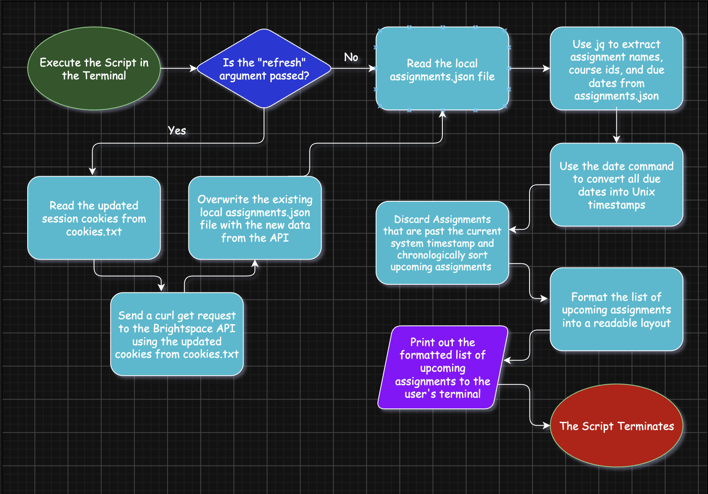

# Homework-Fetch
A Bash Script that can fetch upcoming assignments from Brightspace and display them within the terminal.

## The Problem/Project Goal
I'm trying to solve the hassle of having to log in to Brightspace multiple times a day to check my assignments. I often have to do this to avoid forgetting about assignments. I'm writing this Bash script to solve this problem by fetching upcoming assignments from Brightspace and displaying them within the terminal.

## MVP Scope
* Read session cookies from a local cookies.txt file.
* Fetch raw JSON data from the Brightspace REST API using curl.
* Cache the data locally in the assignments.json file.
* Extract assignments and their details using jq.
* Compare due dates of each assignment against the system timestamp using the date command and drop assignments that are past due.
* Format and print a clean list of upcoming assignments to the terminal.
* Implement a refresh argument that can be used to update the local assignments.json file when cookies.txt has updated session cookies.

## Tech Stack
* **Language**: Bash
* **Commands/Utilities**:
  - curl: Execute HTTP requests and attach session cookies for authentication.
  - jq: Extracting the relevant fields of the API's JSON file.
  - date: Filter assignments by the date string given by the API's JSON file.
* **Data Storage**: 
  - A local JSON file called "assignments.json" will act as a cache to store the fetched assignments.
  - A local txt file called "cookies.txt" will securely store session cookies.
* **External Source**: The Brightspace REST API
  - Will be accessed using curl get requests using the d2LSessionVal and d2LSecureSessionVal cookies.
 
## Future Plans
* - [ ] **Color coding**: Color coded terminal output based on urgency (Ex: Red for due in 24 hrs)
* - [ ] **Due date countdowns**: Text displaying "Due in X days" next to each upcoming assignment instead of the actual due date.
* - [ ] **Auto run**: Make the script run automatically when the terminal is opened

## Author
Pranay Anugu, github.com/Panugu08.
